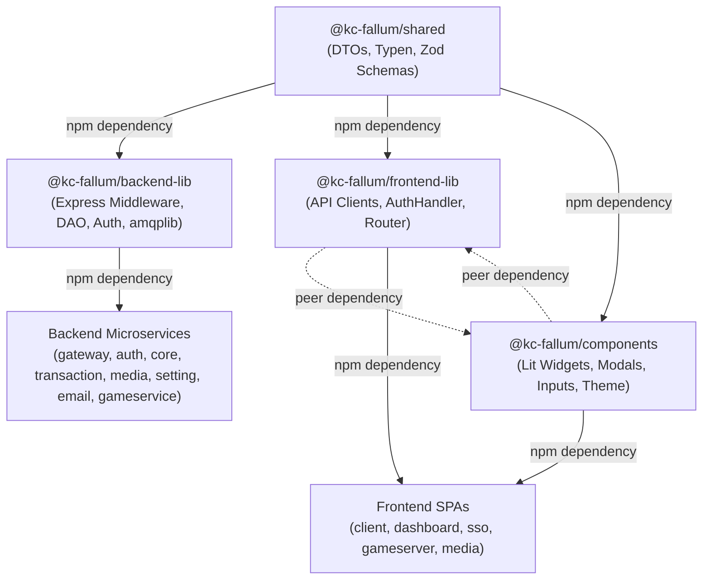

# System- & Code-Architektur

Die **KC Fallum Plattform** ist als modularer Verbund aus spezialisierten Microservices, eigenständigen Lit-Frontends, geteilten npm-Bibliotheken und Minecraft-Server-Plugins aufgebaut.

Das Gesamtsystem vereint ein **Multi-Repo-Prinzip** für unabhängige Versionierung und Deployment-Pipelines mit einem zentralen **Container-Repository (`root`)** für die ganzheitliche lokale Entwicklung und Compose-Orchestrierung.

---

## 1. Repository- & Ordnerstruktur (Container-Repo mit Submodulen)

Das Repository `root` dient als Container. Alle funktionalen Komponenten sind als eigenständige GitHub-Repositories im Org `kc-fallum` gepflegt und über `.gitmodules` als Git-Submodule eingebunden.

```text
root/                                    # Container-Repository (kc-fallum/root)
├── packages/                            # Geteilte npm-Pakete (in GitHub Packages veröffentlicht)
│   ├── shared/shared-library            # @kc-fallum/shared (DTOs, Zod-Schemas, Interfaces)
│   ├── backend/backend-library          # @kc-fallum/backend-lib (Express-Middleware, DAO, Auth, Clients)
│   ├── frontend/frontend-library        # @kc-fallum/frontend-lib (API-Clients, State-Handler, Vite-Config)
│   └── frontend/components              # @kc-fallum/components (Wiederverwendbare Lit-Komponenten)
│
├── backend/                             # Microservice-Backend (Node.js 22, Express 5, TypeORM)
│   ├── backend-gateway                  # API-Gateway & Reverse Proxy (Port 3000)
│   ├── backend-auth                     # OIDC, SSO, WebAuthn & Passkeys
│   ├── backend-core                     # Kerndomäne (Termine, Strafen, Spieler)
│   ├── backend-transaction              # Kassenbuch, Buchungen & S3-Belege
│   ├── backend-media                    # S3-Medienserver & Sharp Bildverarbeitung
│   ├── backend-setting                  # Globale Club-Konfiguration & Beitragshöhen
│   ├── backend-email                    # Asynchroner Mail- & Push-Dienst
│   ├── backend-gameservice              # Docker- & RCON-Verwaltung für Minecraft
│   ├── backend-paypal                   # PayPal-IPN & Spenden-Webhooks (Standalone)
│   └── quickmail                        # Cloudflare-Worker E-Mail-Gateway
│
├── frontend/                            # Single Page Applications (Lit 3, Vite, Tailwind 4)
│   ├── frontend-client                  # Öffentliches Vereins- & Mitglieder-Portal
│   ├── frontend-dashboard               # Administrations-SPA für Vorstände
│   ├── frontend-sso                     # Authentifizierungs- & Passkey-Portal
│   ├── frontend-gameserver              # Management-Konsole für Minecraft-Server
│   └── frontend-media                   # Galerie- & Medienverwaltung (galerie.kcfallum.de)
│
├── game/plugins/                        # Minecraft-Server-Cluster (Java 21, Gradle, Paper API)
│   ├── lib                              # kc-fallum-lib (Gemeinsame Java-API)
│   ├── lobby                            # KC-Lobby (Lobby- & Minigame-Features)
│   └── proxy                            # KC-Proxy (Velocity-Proxy-Erweiterungen)
│
├── workflows/                           # Wiederverwendbare CI/CD GitHub Actions Templates
├── docs/                                # Zentrales Entwicklerportal (Docusaurus + TypeDoc)
├── docker-compose.prod.yml              # Produktions-Stack für den Server (Oracle VPS)
└── docker-compose.test.yml              # Lokaler Test-Stack (PostgreSQL, Redis, RabbitMQ, MinIO)
```

---

## 2. Architekturübersicht aller Frontends & Backends (in 2 Sätzen)

### 2.1 Frontends (Lit 3, Vite, Tailwind 4, 4-Schichten-Muster)

* **`frontend-client`:**
  Die öffentliche Vereins-SPA dient als interaktives Schaufenster des Clubs und stellt Termine, Ranglisten, den Strafenkatalog sowie Anmeldestatus übersichtlich für alle Mitglieder bereit. Die Anwendung wechselt nahtlos zwischen öffentlicher Gast-Ansicht und personalisiertem Spielerprofil mit interaktiven Widgets wie Glücksrad und Siegertreppchen.
* **`frontend-dashboard`:**
  Das geschützte Administrations-Frontend ermöglicht Vorständen die vollständige operative Vereinsverwaltung von Terminen, Kasse, Strafen, Spielern und Systemeinstellungen. Jede Unterseite folgt strikt dem 5-Dateien-Muster und nutzt `@lit/task` für reaktive Lade-, Fehler- und Tabellenansichten.
* **`frontend-sso`:**
  Das zentrale Authentifizierungs-Portal wickelt OIDC-Anmeldungen über passwortlose Passkeys (WebAuthn) oder Google OAuth ab. Durch automatisiertes Cookie-Scoping auf `.kcfallum.de` gewährt ein erfolgreicher Login unmittelbaren Zugriff auf alle Vereins-Subdomains.
* **`frontend-gameserver`:**
  Das Gaming-Dashboard visualisiert den Live-Zustand des Minecraft-Serverclusters und erlaubt autorisierten Benutzern das Starten, Stoppen und Konfigurieren von Container-Instanzen. Eine bidirektionale WebSocket-Verbindung streamt RCON-Konsolenausgaben in Echtzeit direkt in den Browser.
* **`frontend-media` (`frontend-galerie`):**
  Die Galerie-Anwendung erlaubt das Durchstöbern, Taggen und Hochladen hochauflösender Fotos und Event-Alben über eine responsive Masonry- und Lightbox-Ansicht. Dateiuploads werden über vorsignierte MinIO-S3-URLs direkt vom Browser in den Objektspeicher gestreamt, ohne das Backend mit Dateibytes zu belasten.

### 2.2 Backends (Express 5, TypeORM, Zod 4, 5-Schichten-Muster)

* **`backend-gateway`:**
  Der zentrale HTTP- und WebSocket-Reverse-Proxy schirmt das interne Docker-Netzwerk ab und bündelt Sicherheits-Header, Cors-Policies und IP-basierte Rate-Limits. Er routet eingehende Anfragen anhand des URL-Präfixes an den zuständigen Microservice und transformiert Authentifizierungs-Cookies für alle Subdomains.
* **`backend-auth`:**
  Der Identitäts- und Autorisierungsdienst fungiert als zertifizierter OpenID-Connect-Provider mit WebAuthn/FIDO2- und Passport-Google-Unterstützung. Er verwaltet Benutzerkonten, API-Schlüssel und granulare Rollenberechtigungen in einer separaten PostgreSQL-Datenbank.
* **`backend-core`:**
  Die Kerndomäne orchestriert alle fachlichen Club-Abläufe rund um Termine, Anwesenheiten, Spielerprofile und das Zuweisen von Katalogstrafen. Ein integrierter Cron-Job synchronisiert anwesende Spieler und aufgelaufene Strafen periodisch mit Google Sheets zur externen Revision.
* **`backend-transaction`:**
  Der Finanzservice führt das revisionssichere Kassenbuch des Vereins, bilanziert Einnahmen, Ausgaben sowie Mitgliedsbeiträge und verknüpft Buchungen mit Belegdateien. Über synchrone Service-Clients werden Beleg-PDFs und Quittungen direkt im MinIO S3-Bucket archiviert.
* **`backend-media`:**
  Der Mediendienst verarbeitet Multimediadateien, generiert performante WebP-Thumbnails mittels Sharp und verwaltet Bucket-Metadaten. Er stellt geschützte Endpunkte zur Ausstellung kurzlebiger S3-Presigned-URLs für Browser-Uploads und Downloads bereit.
* **`backend-setting`:**
  Der Konfigurationsservice persistiert globale Vereinsparameter wie Theme-Farben, Club-Logos, Monatsbeiträge und Strafenkatalog-Kategorien. Er dient als Single Source of Truth für alle anpassbaren Design- und Regelparameter der Frontends.
* **`backend-email`:**
  Der Benachrichtigungsdienst konsumiert asynchrone E-Mail- und Push-Aufträge aus einer RabbitMQ-Message-Queue und rendert typisierte Templates mittels React Email. Er versendet Transaktions-Mails zuverlässig über den Resend-Provider und informiert Benutzer per Web-Push im Browser.
* **`backend-gameservice`:**
  Der Infrastruktur-Dienst steuert die lokalen Minecraft-Docker-Container über die Dockerode-API und überwacht Serverressourcen wie CPU und RAM. Autorisierte RCON-Kommandos und Server-Backups werden über gesicherte Endpunkte und WebSockets ausgeführt.
* **`backend-paypal` & `quickmail`:**
  `backend-paypal` empfängt Instant Payment Notifications (IPN) für Club-Spenden und leitet Gutschriften an den Kassen-Service weiter. `quickmail` agiert als schlanker Cloudflare-Worker zur Ausführung zustandsloser Mailversand-Aufträge über die Resend-API.

---

## 3. Inter-Paket- & Submodul-Abhängigkeitsmatrix

Das System erzwingt eine strikte Hierarchie der Abhängigkeiten. Kein Submodul darf zirkulär auf höherliegende Schichten zugreifen.



### 3.1 Geteilte npm-Pakete im Detail

| Paketname | Pfad im Container | Abhängig von | Aufgabe & Inhalt |
|---|---|---|---|
| `@kc-fallum/shared` | `packages/shared/shared-library` | *(keine)* | Universelle DTOs, Zod-Validierungsschemata, Enums, Berechtigungs-Arrays (`authPermissions`, `corePermissions`). Von Backend und Frontend genutzt. |
| `@kc-fallum/backend-lib` | `packages/backend/backend-library` | `shared` | Basisklasse `BaseEntity`, `GenericDAO`, Express-Middlewares (`validateBody`, `validateParams`, `requireAuth`), `MessageBroker` (RabbitMQ), Service-Clients. |
| `@kc-fallum/frontend-lib` | `packages/frontend/frontend-library` | `shared` (Peer: `components`) | Typisierte API-Clients (`terminClient`, `kasseClient`, etc.), `authHandler`, `NotificationHandler`, Push-Handler, `vite-config`-Basis. |
| `@kc-fallum/components` | `packages/frontend/components` | `frontend-lib`, `shared` | Wiederverwendbare Web Components: Buttons, Inputs, Dialoge (`ModalForm`, `MessageForm`), Tabellen (`TableWidget`), Theming-Tokens (`variables.css`). |

### 3.2 Build- & Publish-Reihenfolge

Da Submodule über GitHub Packages (`npm.pkg.github.com`) miteinander kommunizieren, gilt bei Aktualisierungen folgende strikte Reihenfolge:

1. **Stufe 1:** `@kc-fallum/shared` wird gebaut, getestet und als neue Version veröffentlicht.
2. **Stufe 2:** `@kc-fallum/backend-lib` übernimmt die neue `shared`-Version &rarr; Build & Publish.
3. **Stufe 3:** `@kc-fallum/frontend-lib` und `@kc-fallum/components` werden mit der neuen `shared`-Version aktualisiert und veröffentlicht.
4. **Stufe 4:** Backend-Services und Frontends ziehen die aktualisierten `@kc-fallum/*`-Pakete per `npm update` ein.

---

## 4. Strikte Paket- & Workspace-Regeln

> [!CAUTION]
> **Niemals lokale `file:`-Verknüpfungen oder Workspace-Links committen!**
> Die npm-Workspaces in `root/package.json` existieren **ausschließlich für lokale Hilfs-Scripts** (`npm run build`, `npm run lint`).
> 
> * In CI/CD-Pipelines checkt GitHub Actions jedes Submodul isoliert in eine saubere VM aus.
> * Lockfiles (`package-lock.json`) dürfen **kein `"link": true`** und keine Pfade wie `../../packages/...` enthalten.
> * Alle `@kc-fallum/*`-Dependencies müssen als gültige SemVer-Range (z.&nbsp;B. `^1.0.0`) deklariert sein.
> * Vor jedem Git-Commit muss geprüft werden, dass `package-lock.json` für alle internen Pakete auf `https://npm.pkg.github.com/...` verweist.
