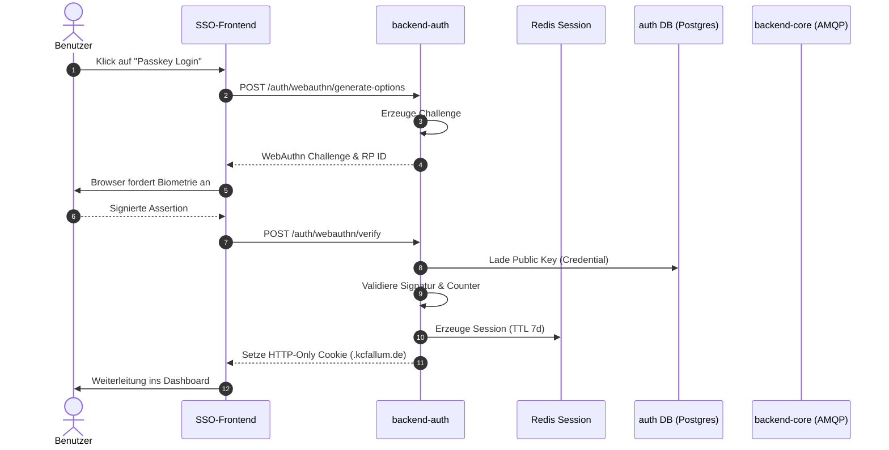

import CodeBlock from '@theme/CodeBlock';
import IndexRoutesSource from '../../../../backend/backend-auth/src/routes/index.routes.ts?raw';

# Auth & Identity Service (`backend-auth`)

Der **Auth Service** ist der zentrale Identitäts- und Autorisierungsdienst der KC Fallum Plattform. Er kombiniert klassische REST-Authentifizierung mit modernsten Identitätsstandards wie **OpenID Connect (OIDC)** und passwortlosen **FIDO2/WebAuthn-Passkeys**.

---

## 1. Aufgaben & Sicherheits-Schwerpunkte

* **OpenID Connect Provider (`/oidc`):** Vollwertige OIDC-Endpunkte (`.well-known/openid-configuration`, `authorize`, `token`, `userinfo`) zur Authentifizierung von Subsystemen wie Beszel-Monitoring.
* **Passwortlose FIDO2/WebAuthn-Anmeldung:** Registrierung und Verifikation biometrischer Passkeys (TouchID, FaceID, Windows Hello, YubiKey) über `@simplewebauthn/server`.
* **Google OAuth2 Integration:** Single Sign-On (SSO) mittels Passport-Strategie (`passport-google-oauth20`).
* **Session-Verwaltung in Redis:** Schnelle Session-Lookup- und Invalidierungsmechanismen via Redis-Cache und HTTP-Only-Cookies auf `.kcfallum.de`.
* **API-Key-Verwaltung:** Erstellung kryptografisch sicherer API-Tokens mit granularen Permission-Scopes für Drittanwendungen.
* **Event-Broadcasting:** Publiziert Profil-Events (`events.profile.created`, `events.profile.updated`) via RabbitMQ an den Core-Service.

---

## 2. Architektur des Authentifizierungs-Flows

---

## 3. Routen-Übersicht & Index-Schalthebel

Die Datei `src/routes/index.routes.ts` gliedert die Authentifizierung in spezialisierte Controller:

<CodeBlock language="typescript" title="backend/backend-auth/src/routes/index.routes.ts">
  {IndexRoutesSource}
</CodeBlock>
