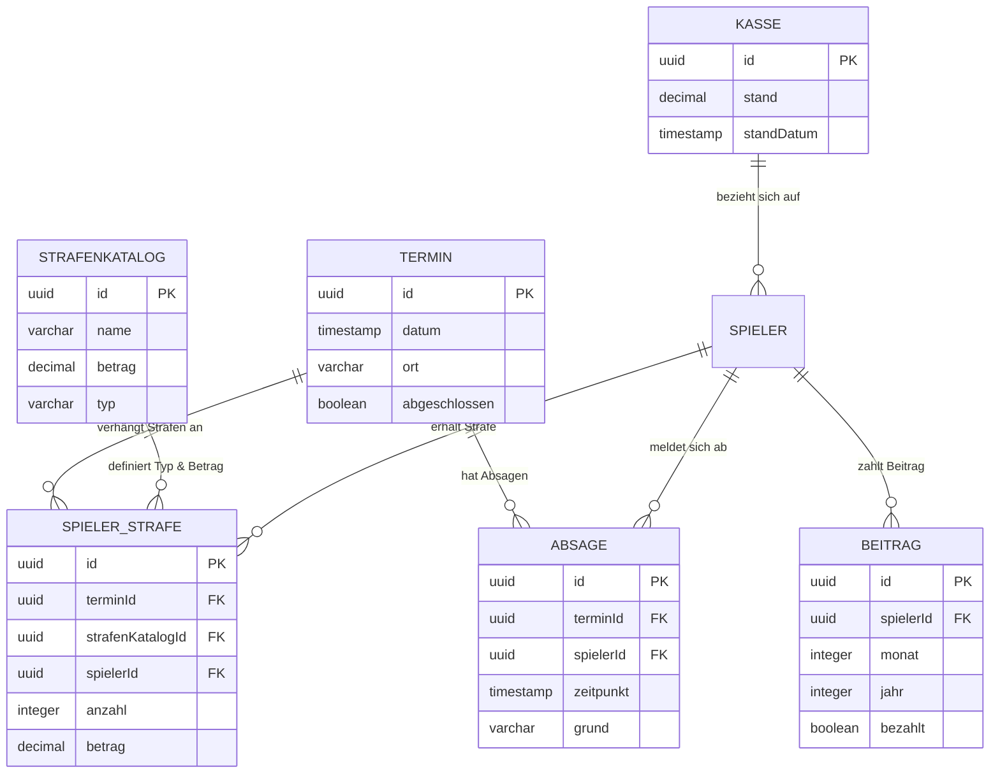

import CodeBlock from '@theme/CodeBlock';
import IndexRoutesSource from '../../../../backend/backend-core/src/routes/index.routes.ts?raw';

# Core Service (`backend-core`)

Der **Core Service** bildet das Herzstück der KC Fallum Plattform. Er verwaltet die Kerndomänen des Vereins und speichert alle operativen Daten in der PostgreSQL-Datenbank `kegelclub`.

---

## 1. Aufgaben & Verantwortlichkeiten

* **Terminverwaltung (`/termin`):** Erstellen, Planen, Vorziehen, Absagen und Abschließen von Kegelabenden.
* **Absage-Management (`/absage`):** Verwaltung von Spielerabmeldungen mit Zeitstempeln (vor/nach Meldefrist).
* **Strafen & Strafenkatalog (`/strafen`, `/katalog`):** Vollständige Erfassung aller im Verein verhängten Strafen, Klassifizierung nach Kategorien (z. B. Spiel, Kegel, Vergehen) und konfigurierbare Festbeträge.
* **Kasse & Salden (`/kasse`):** Aggregation von offenen Strafen, Einzahlungen und Ausgaben zu einem konsolidierten Kassenstand.
* **Beitragsverwaltung (`/beitrag`):** Monatliche Beitragserhebung für aktive Mitglieder.
* **Google Sheets Synchronisation:** Bidirektionale Synchronisation mit Google Spreadsheets zur externen Ansicht und Archivierung via Google Service Account.
* **Echtzeit-Broadcasting:** Benachrichtigt verbundene Frontends via Socket.io über Events wie `STRAFE_CREATED`, `STRAFE_DELETED` oder `TERMIN_CLOSED`.

---

## 2. Datenbank-Schema (`kegelclub`)

Der Dienst verwendet 6 relationale Entitäten:

---

## 3. Routen-Übersicht & Index-Schalthebel

Alle Endpunkte des Core-Service werden über `src/routes/index.routes.ts` gesteuert. Öffentliche Routen (wie `/katalog`) werden direkt exponiert, während alle verwaltenden Routen durch die `authenticate`-Middleware geschützt sind:

<CodeBlock language="typescript" title="backend/backend-core/src/routes/index.routes.ts">
  {IndexRoutesSource}
</CodeBlock>
