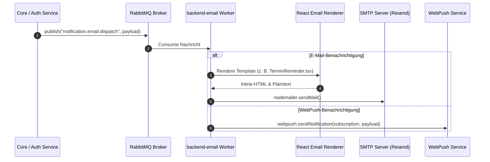

# Email & Push Service (`backend-email`)

Der **Email & Push Service** ist der asynchrone Kommunikations-Worker der Plattform. Er konsumiert Nachrichten aus dem RabbitMQ-Broker, rendert responsive HTML-Mails mit **React Email**, generiert animierte Countdown-GIFs und versendet WebPush-Benachrichtigungen an Endgeräte.

---

## 1. Aufgaben & Kernfunktionen

* **Event-getriebene Abarbeitung:** Lauscht auf dedizierte Routing-Keys wie `notification.email.dispatch` und `notification.push.dispatch`.
* **React Email Rendering:** E-Mail-Vorlagen werden deklarativ als React-Komponenten (`.tsx`) geschrieben und serverseitig zu inline-gestyltem HTML gerendert.
* **Dynamische Countdown-GIFs (`gifenc`):** Erzeugt on-the-fly animierte GIF-Grafiken, die in E-Mails die verbleibende Zeit bis zum nächsten Kegelabend sekundengenau herunterzählen.
* **WebPush & VAPID:** Signiert und versendet Push-Nachrichten an Browser über die WebPush-Spezifikation (`web-push`).
* **SMTP- & IMAP-Anbindung:** Nutzt Nodemailer für den gesicherten Versand über SMTP und überwacht Postfächer optional per IMAP.

---

## 2. Der Dispatcher-Flow

