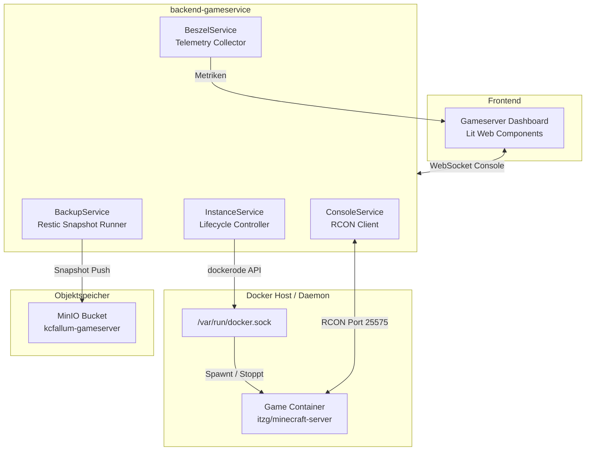

import CodeBlock from '@theme/CodeBlock';
import IndexRoutesSource from '../../../../backend/backend-gameservice/src/routes/index.routes.ts?raw';

# Gameservice (`backend-gameservice`)

Der **Gameservice** ist der Infrastruktur- und Orchestrierungsdienst für Gaming-Instanzen (insbesondere PaperMC/Minecraft). Er kommuniziert über den Docker-Host-Socket direkt mit dem Docker-Daemon (`dockerode`), steuert Spieleserver per **RCON-Protokoll**, streamt interaktive Konsolenausgaben über WebSockets und sichert Welten automatisiert via **Restic**.

---

## 1. Aufgaben & Infrastruktur-Integration

* **Dockerode Host-Steuerung:** Bindet `/var/run/docker.sock` ein, um Container (`itzg/minecraft-server`) dynamisch zu starten, zu stoppen und Ressourcenlimits (CPU, RAM bis max. 10 GB) zu erzwingen.
* **RCON Echtzeit-Steuerung:** Führt administrative Befehle (`op`, `whitelist`, `gamerule`, `say`) synchron auf dem Minecraft-Server aus.
* **Interaktives Konsolen-Streaming:** Streamt stdout/stderr des Docker-Containers in Echtzeit über Socket.io an das Frontend und erlaubt interaktive Eingaben.
* **Restic Snapshot-Backups:** Führt differenzielle, verschlüsselte Sicherungen in den MinIO-Bucket `kcfallum-gameserver` aus.
* **Beszel Telemetrie:** Ruft Auslastungsdaten (CPU, RAM, I/O) der Gaming-Container über die Beszel-API ab.
* **Velocity- & Geyser/Floodgate-Injektion:** Injiziert kryptografische Secrets für den Velocity-Proxy und Bedrock-Crossplay.

---

## 2. Die Orchestrierungs-Architektur

---

## 3. Routen-Übersicht & Index-Schalthebel

Die Datei `src/routes/index.routes.ts` bündelt alle Endpunkte für Instanzen, Konsolen, Backups und Konfigurationen:

<CodeBlock language="typescript" title="backend/backend-gameservice/src/routes/index.routes.ts">
  {IndexRoutesSource}
</CodeBlock>
