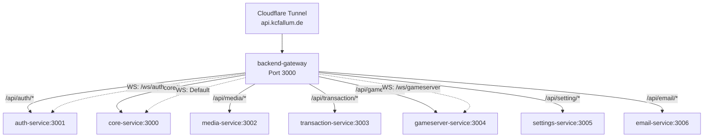

import CodeBlock from '@theme/CodeBlock';
import GatewayAppSource from '../../../../backend/backend-gateway/src/app.ts?raw';

# API Gateway (`backend-gateway`)

Das **API Gateway** ist die zentrale Eingangspforte für sämtlichen externen HTTP- und WebSocket-Traffic der Plattform. Es ist als **vollständig zustandsloser Proxy (Stateless)** konzipiert und besitzt bewusst keine eigene Datenbank.

---

## 1. Aufgaben & Schutzmechanismen

* **Zentraler Reverse Proxy (`http-proxy-middleware`):** Verteilt eingehende REST-Aufrufe anhand des URL-Präfixes transparent an die internen Microservices.
* **CORS- & Sicherheits-Header:** Schützt Clients mittels Helmet, restriktiven Content Security Policies (`csp.config.ts`) und strenger Origin-Prüfung (`cors.config.ts`).
* **Rate-Limiting:** Blockiert Brute-Force- und Denial-of-Service-Angriffe durch zeitfensterbasierte IP-Drosselung.
* **Cookie-Domain Rewriting:** Schreibt Authentifizierungs-Cookies auf die Root-Domain `.kcfallum.de` um, sodass Session-Cookies nahtlos über alle Subdomains (`sso.`, `dashboard.`, `gameserver.`) geteilt werden.
* **Socket.io Upgrade-Routing:** Analysiert WebSocket-Handshakes und leitet die TCP-Verbindung an den zuständigen Backend-Dienst weiter.

---

## 2. Der Gateway-Routing-Aufbau

---

## 3. Live-Code: Gateway-Applikation (`app.ts`)

<CodeBlock language="typescript" title="backend/backend-gateway/src/app.ts">
  {GatewayAppSource}
</CodeBlock>
