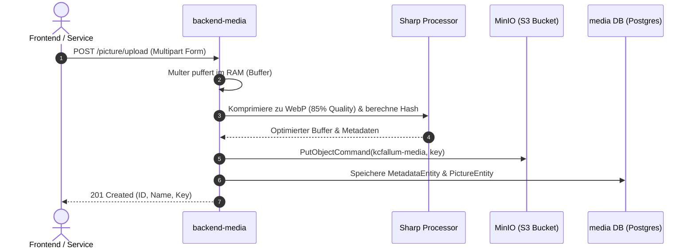

import CodeBlock from '@theme/CodeBlock';
import IndexRoutesSource from '../../../../backend/backend-media/src/routes/index.routes.ts?raw';

# Media Service (`backend-media`)

Der **Media Service** ist der zentrale Dateispeicher- und Asset-Verarbeitungsdienst der KC Fallum Plattform. Er abstrahiert den darunterliegenden MinIO S3-Objektspeicher, verarbeitet Medienströme hochperformant im Arbeitsspeicher und liefert Dateien über signierte URLs aus.

---

## 1. Aufgaben & Verarbeitungs-Pipeline

* **In-Memory Streaming:** Uploads werden via `multer.memoryStorage()` direkt im RAM gepuffert, um unnötige Festplatten-I/O auf dem Host zu vermeiden.
* **Sharp Bildoptimierung:** Konvertiert Bilddateien automatisiert in moderne, komprimierte WebP-Assets, entfernt Datenschutz-kritische Exif-Metadaten und skaliert Vorschaubilder (Thumbnails).
* **S3/MinIO Objektspeicher:** Speichert alle Binärdaten im dedizierten Bucket `kcfallum-media`.
* **Presigned URLs (`generatePresignedUrl`):** Schützt private Dateien vor unberechtigtem Direktzugriff. Clients erhalten zeitlich begrenzte Download-URLs (Standard: 3600 Sekunden Gültigkeit).
* **Zugriffssteuerung (`AccessEntity`):** Ermöglicht die Freigabe von Alben und Dokumenten für bestimmte Benutzer oder Rollen.

---

## 2. Die Media-Upload-Pipeline

---

## 3. Routen-Übersicht & Index-Schalthebel

Die Datei `src/routes/index.routes.ts` bündelt alle Media-Endpunkte und schützt sie durch Berechtigungsprüfungen:

<CodeBlock language="typescript" title="backend/backend-media/src/routes/index.routes.ts">
  {IndexRoutesSource}
</CodeBlock>
