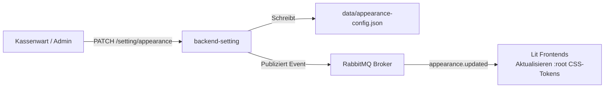

# Settings Service (`backend-setting`)

Der **Settings Service** verwaltet globale Vereinseinstellungen, Farbschemata (Theming) und speichert WebPush-Abonnements für Benachrichtigungen. Er legt seine Daten in der PostgreSQL-Datenbank `settings` ab.

---

## 1. Aufgaben & Kernfunktionen

* **Globales Theming & Design:** Verwaltet dynamische CSS-Custom-Properties (Farben für Primäridentität, Warnungen, Erfolge, Hintergründe, Trennlinien) für den Light- und Dark-Mode.
* **Vereinsstammdaten:** Definiert den Vereinsnamen (`club: "KCFallum"`) und die Dokumenten-ID des Vereinslogos (`logoDocumentId`).
* **WebPush-Subscription-Verwaltung:** Registriert Push-Abonnements von Browsern (`endpoint`, `keys.p256dh`, `keys.auth`) im JSONB-Format zur Auslieferung von Push-Nachrichten über das `backend-email`.
* **Live-Event Sync:** Publiziert Änderungen am Vereinstheming via RabbitMQ, sodass verbundene Frontends ihr Design in Echtzeit anpassen können.

---

## 2. Theming-Architektur

