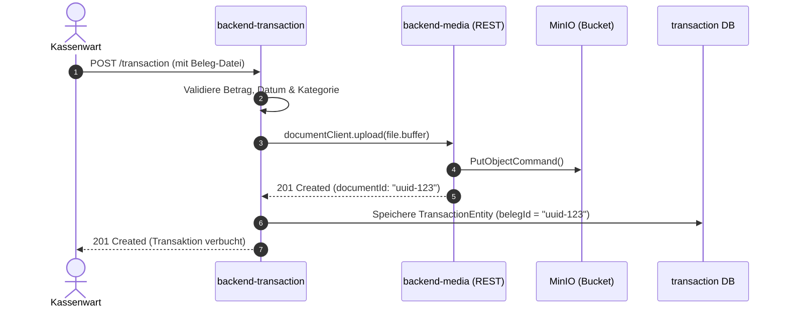

import CodeBlock from '@theme/CodeBlock';
import IndexRoutesSource from '../../../../backend/backend-transaction/src/routes/index.routes.ts?raw';

# Transaction Service (`backend-transaction`)

Der **Transaction Service** ist das buchhalterische Kontrollorgan der Plattform. Er verwaltet das revisionssichere Kassenbuch des Vereins, dokumentiert alle Ein- und Auszahlungen und delegiert Beleg-Uploads synchron an den Media Service.

---

## 1. Aufgaben & Architektur-Besonderheiten

* **Revisionssichere Buchungssätze:** Jede finanzielle Bewegung (Beitragseingang, Bar-Einzahlung, Auslagen für Bahnmiete oder Pokale) wird als unveränderliche `TransactionEntity` festgeschrieben.
* **Keine eigene Dateispeicherung (Cross-Service Delegation):** Der Dienst besitzt absichtlich keine direkte S3-Anbindung. Werden Belege hochgeladen, delegiert der Service die Rohdaten über den `documentClient` aus `@kc-fallum/backend-lib` per HTTP-Multipart-Aufruf an das `backend-media`.
* **Kassensaldo & Audit:** Berechnet aktuelle Kassenbestände und ermöglicht Wirtschaftsprüfungen durch die Kassenprüfer.
* **Google Sheets Integration:** Synchronisiert historische Buchungssätze mit der Buchhaltungs-Tabelle `tabellenblatt11`.

---

## 2. Der Cross-Service Beleg-Upload-Flow

---

## 3. Routen-Übersicht & Index-Schalthebel

Die Datei `src/routes/index.routes.ts` bündelt alle Buchungsendpunkte:

<CodeBlock language="typescript" title="backend/backend-transaction/src/routes/index.routes.ts">
  {IndexRoutesSource}
</CodeBlock>
