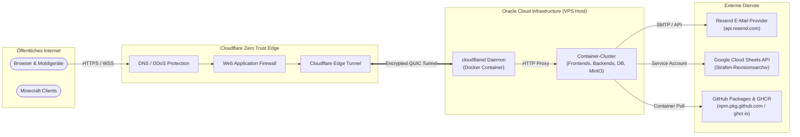
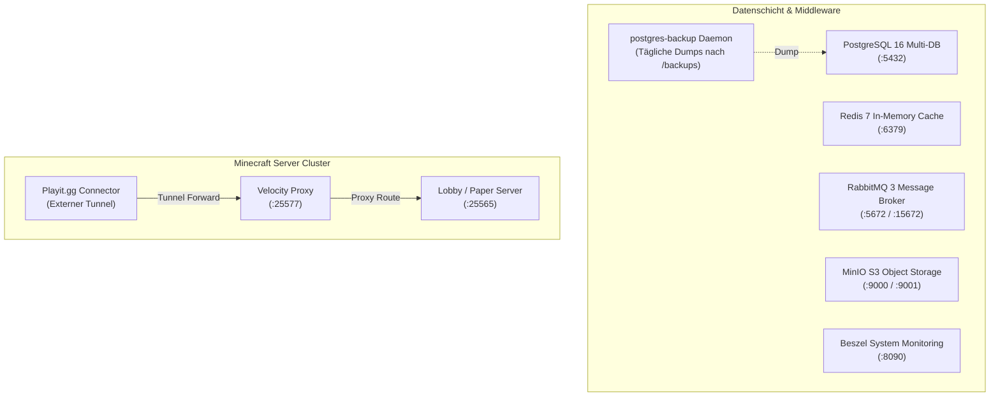

# Infrastruktur & Dependencies

Die KC Fallum Plattform setzt auf ein hochgradig modulares und ausfallsicheres Infrastruktur-Setup. Dieses Dokument beschreibt alle **externen Cloud-Provider**, die **interne Docker-Container-Landschaft** sowie das **npm-Paket-Ökosystem**.

---

## 1. Externe Cloud-Infrastruktur & SaaS-Dienste



### 1.1 Oracle Cloud Infrastructure (VPS Host)

Die Plattform wird produktiv auf einer dedizierten Compute-Instanz in der Oracle Cloud betrieben.

* **Betriebssystem:** Ubuntu 24.04 LTS (x86_64 / ARM64 Ampere A1).
* **Ressourcenausstattung:** 4 OCPU Cores, 24 GB Arbeitsspeicher, 100 GB NVMe-Boot-Volume.
* **Firewall & Ports:** Sämtliche eingehenden Ports (80, 443, 3000) sind in der Host-Firewall (`ufw` / OCI Security Lists) **vollständig geschlossen**. Zugriff von außen erfolgt ausschließlich über den ausgehenden Cloudflare-Tunnel.
* **Dateisystem-Pfade auf dem Host:**
  ```text
  /opt/deployment/kcfallum/
  ├── docker-compose.prod.yml    # Produktions-Stack für alle Services
  ├── .env                       # Produktions-Umgebungsvariablen
  ├── backups/                   # Automatische PostgreSQL Dumps (postgres-backup)
  ├── beszel_data/               # Metriken des Server-Monitorings
  ├── minio_data/                # Persistente S3-Objektdaten
  └── game/                      # Persistente Welten- und Plugin-Konfigurationen
  ```

---

### 1.2 Cloudflare Zero Trust & Tunnel-Routing

Der Docker-Container `cloudflared` initiiert ausgehende TLS-Verbindungen zu Cloudflare-Edge-Knoten. Externe HTTP/WebSocket-Anfragen werden über verschlüsselte Tunnel empfangen und an das interne Docker-Netzwerk `cloudflare_net` weitergeleitet.

#### Public Hostname Routing-Matrix

| Öffentliche Domain | Internes Docker-Ziel | Protokoll | Funktion & Dienst |
|---|---|---|---|
| `kcfallum.de` | `http://client:80` | HTTP | Öffentliche Vereins-Webseite & Mitglieder-SPA |
| `auth.kcfallum.de` | `http://sso:80` | HTTP | Single Sign-On, OIDC, WebAuthn & Passkeys |
| `dashboard.kcfallum.de` | `http://dashboard:80` | HTTP | Administrations-Dashboard für Vorstände |
| `galerie.kcfallum.de` | `http://gallery:80` | HTTP | Medien- & Fotoalben-Verwaltung |
| `game.kcfallum.de` | `http://gameserver:80` | HTTP / WS | Minecraft-Server Web-Interface & RCON-Streaming |
| `api.kcfallum.de` | `http://gateway:3000` | HTTP / WS | Zentrales Backend-Gateway für alle REST- & Socket-APIs |
| `media.kcfallum.de` | `http://minio:9000` | HTTP | S3-Objektspeicher (Bilder, Dokumente, Belege) |
| `status.kcfallum.de` | `http://beszel:8090` | HTTP | Beszel Host- & Container-Monitoring |

> [!IMPORTANT]
> Für die Domains `api.kcfallum.de` und `game.kcfallum.de` ist in den Cloudflare Zero Trust Tunnel-Einstellungen unter **HTTP Settings &rarr; WebSockets** die WebSocket-Unterstützung zwingend aktiviert.

---

### 1.3 Resend E-Mail-Dienst & Quickmail

Der E-Mail-Versand erfolgt über die Resend-Plattform für garantierte Zustellbarkeit und DKIM/SPF/DMARC-Konformität:

* **Asynchroner Versand:** Fachdienste (`backend-core`, `backend-auth`) publizieren Mail-Events auf die RabbitMQ-Warteschlange `email.send`.
* **Templating & Generierung:** `backend-email` konsumiert die Aufträge, rendert das Design via React Email und versendet die E-Mail über die Resend REST-API (`https://api.resend.com/emails`) oder SMTP (`smtp.resend.com:587`).
* **Zustandsloses Gateway:** Der Cloudflare-Worker `quickmail` fungiert als leichtgewichtiger Fallback-Endpunkt für Serverless-Umgebungen.

---

### 1.4 GitHub Source Control & GitHub Packages

* **Repository-Topologie:** Container-Repo `kc-fallum/root` verwaltet alle Submodule im Org `kc-fallum`.
* **NPM Registry:** Alle `@kc-fallum/*`-Pakete werden über die scoped GitHub Packages Registry bezogen:
  ```ini title=".npmrc"
  @kc-fallum:registry=https://npm.pkg.github.com
  //npm.pkg.github.com/:_authToken=${NODE_AUTH_TOKEN}
  ```
* **Container Registry (GHCR):** Alle Service-Images werden in `ghcr.io/kc-fallum/<image-name>:${APP_VERSION}` veröffentlicht.

---

## 2. Interne Container-Infrastruktur (`docker-compose.prod.yml`)

Alle internen Basisdienste laufen als isolierte Container innerhalb desselben Host-Netzwerks.



### 2.1 Technische Rollen der Basisdienste

| Container-Dienst | Basis-Image | Aufgabe im Gesamtsystem | Persistenz & Volumes |
|---|---|---|---|
| `postgres` | `postgres:16` | Primäre relationale Datenbank für alle Backend-Dienste mit separaten Schemata/Datenbanken. | `postgres_data:/var/lib/postgresql/data` |
| `postgres-backup` | `prodrigestivill/postgres-backup-local` | Erzeugt täglich rotierende Dumps (`pg_dumpall`) und bewahrt sie 14 Tage auf. | `/opt/deployment/kcfallum/backups` |
| `redis` | `redis:7-alpine` | Schneller Cache für OIDC-Sitzungen, API-Key-Validierungen und IP-Rate-Limiting. | In-Memory (Optional RDB) |
| `rabbitmq` | `rabbitmq:3-management-alpine` | AMQP 0-9-1 Message Broker für entkoppelte Benachrichtigungen, Push-Events und Log-Ereignisse. | `rabbitmq_data:/var/lib/rabbitmq` |
| `minio` | `minio/minio:RELEASE...` | S3-kompatibler Objektspeicher für Vereinsbelege, Quittungen, Profilfotos und Event-Galerien. | `minio_data:/data` |
| `minio-init` | `minio/mc` | Initialisierungs-Container zur automatischen Erstellung und Absicherung der Standard-Buckets. | Zustandslos (Runs on boot) |
| `beszel` | `henrygd/beszel:latest` | Zentrale Visualisierung von CPU-, RAM-, Disk- und Container-Metriken. | `beszel_data:/beszel_data` |

---

## 3. Interne Software- & Paket-Abhängigkeiten

### 3.1 Das `@kc-fallum`-Ökosystem

Die interne Wiederverwendung von Code wird durch vier npm-Bibliotheken realisiert:

```text
@kc-fallum/shared (v1.x)
  ├── @kc-fallum/backend-lib (v1.x)  ──► Backend Microservices (gateway, core, auth, etc.)
  └── @kc-fallum/frontend-lib (v1.x) ──┬──► Frontend SPAs (client, dashboard, sso, etc.)
       ▲                             │
       └── @kc-fallum/components (v1.x) ┘
```

1. **`@kc-fallum/shared`:**
   * **Inhalt:** Universelle DTO-Typdefinitionen, Berechtigungs-Matrizen (`corePermissions`, `authPermissions`), Zod-Schemas für Transferobjekte.
   * **Verwendung:** Wird von ausnahmslos allen Frontends, Backends und Bibliotheken importiert.
2. **`@kc-fallum/backend-lib`:**
   * **Inhalt:** `BaseEntity`, `GenericDAO<T>`, Express-Middlewares (`requireAuth`, `validateBody`), `MessageBroker`-Wrapper für `amqplib`, HTTP-Service-Clients für Inter-Service-Kommunikation.
   * **Verwendung:** Standard-Laufzeitbibliothek aller Node.js-Backend-Dienste.
3. **`@kc-fallum/frontend-lib`:**
   * **Inhalt:** Typisierte API-Clients (`authClient`, `terminClient`, `kasseClient`, etc.), `authHandler` mit Berechtigungs-Prüfung, `NotificationHandler`, Push-Manager und shared `vite-config`.
   * **Verwendung:** Standard-Laufzeitbibliothek aller Lit-Frontends.
4. **`@kc-fallum/components`:**
   * **Inhalt:** Lit 3 Komponenten-Bibliothek (`<button-input>`, `<table-widget>`, `<page-layout>`, `<skeleton-widget>`, `<error-widget>`, `<tabs-switch>`, Modal-Klassen `ModalForm`, `MessageForm`).
   * **Verwendung:** UI-Basis für alle SPAs.

---

## 4. Regeln für Submodule und Lockfiles

> [!CAUTION]
> **Keine Workspace-Verknüpfungen in committeten Lockfiles!**
> 
> * **Kein `"link": true`:** Beim Arbeiten im Root-Workspace schreibt `npm install` relative Pfade (`../../packages/...`) in Submodul-Lockfiles. Solche Änderungen dürfen **niemals** committed werden.
> * **Isolierte CI-Builds:** Im CI-Runner wird nur das einzelne Submodul ausgecheckt. Befindet sich ein relativer Workspace-Link im Lockfile, schlägt die Installation im CI mit `ERR_MODULE_NOT_FOUND` fehl.
> * **Paket-Installationen:** Submodul-Dependencies werden stets im Verzeichnis des jeweiligen Submoduls (`cd <submodul> && npm install`) gegen die GitHub Packages Registry installiert.
