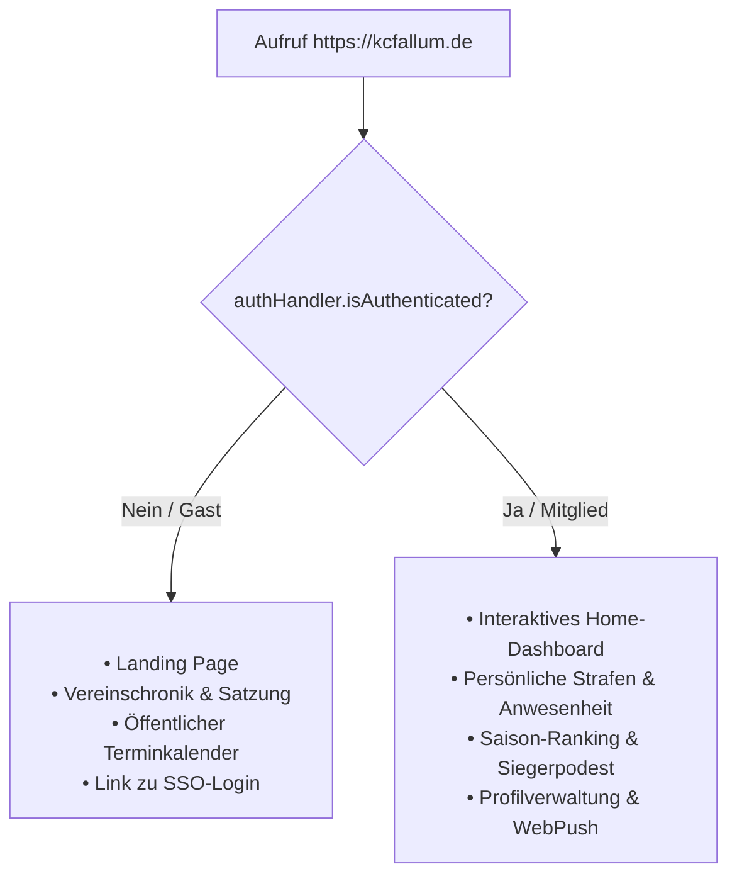

import CodeBlock from '@theme/CodeBlock';
import NavigationConfigSource from '../../../../frontend/frontend-client/src/navigation.config.ts?raw';

# Client Portal (`frontend-client`)

Das Submodul `frontend/frontend-client` ist das primäre Webportal des Kegelclubs unter `https://kcfallum.de` (lokal Port 8080). Es kombiniert einen öffentlichen Außenauftritt für Interessenten mit einem geschützten Mitgliederportal.

---

## 1. Die Public/Private Weiche

Die Einstiegskomponente `src/components/app/app.ts` entscheidet reaktiv über den Authentifizierungsstatus des `authHandler`:

---

## 2. Dynamische Navigation (`navigation.config.ts`)

Die sichtbaren Navigationspunkte werden zur Laufzeit strikt über Berechtigungsprüfungen (`corePermissions`, `authPermissions`) generiert:

<CodeBlock language="typescript" title="frontend/frontend-client/src/navigation.config.ts">
  {NavigationConfigSource}
</CodeBlock>
