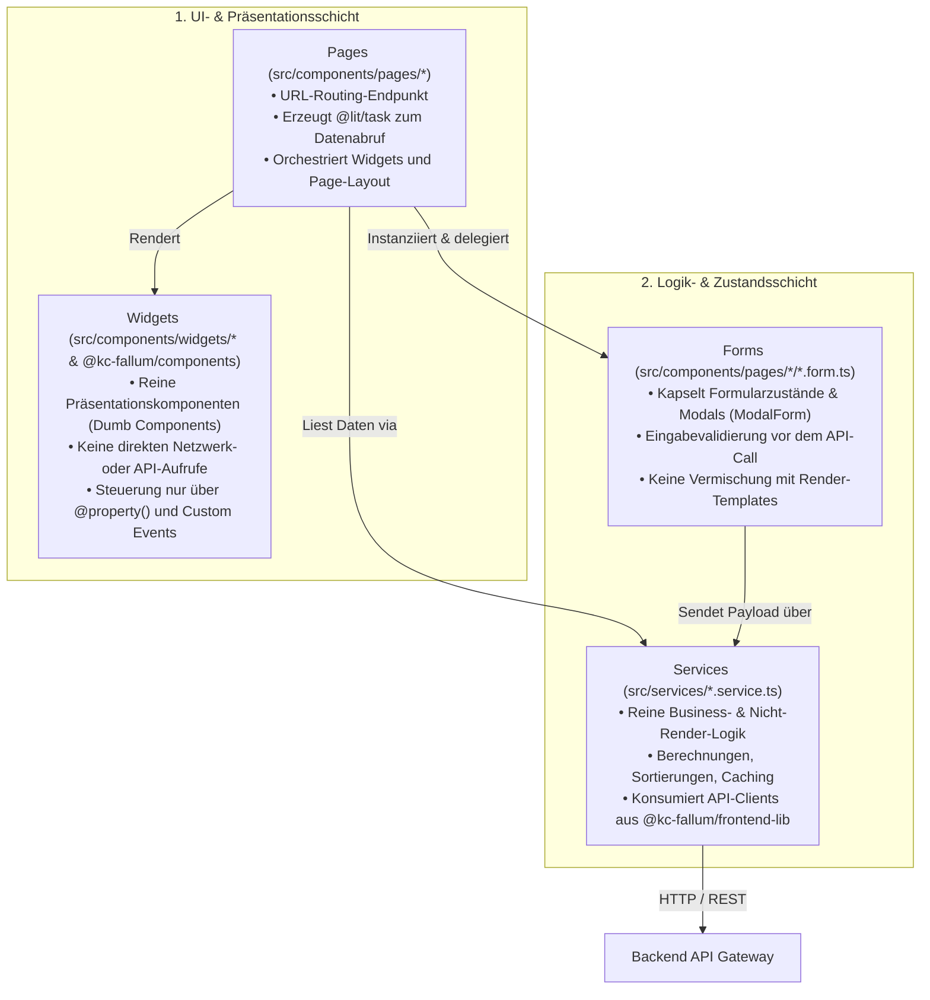
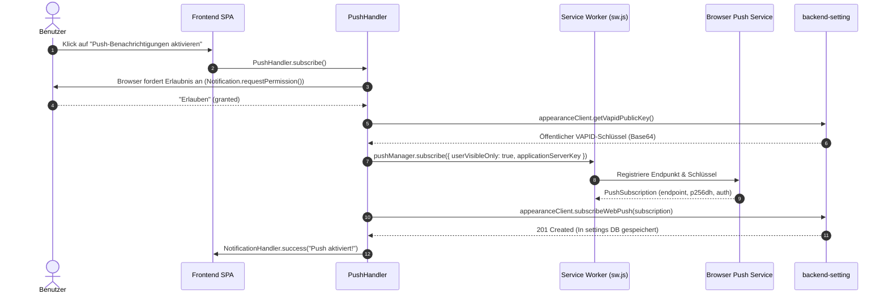

import CodeBlock from '@theme/CodeBlock';
import TerminPageSource from '../../../frontend/frontend-dashboard/src/components/pages/termin/termin.page.ts?raw';
import TerminFormSource from '../../../frontend/frontend-dashboard/src/components/pages/termin/termin.form.ts?raw';
import TerminServiceSource from '../../../frontend/frontend-dashboard/src/services/termin.service.ts?raw';

# Frontend-Architektur & UI-Blueprint

Dieses Dokument definiert die verbindlichen Architektur- und Entwicklungsrichtlinien für alle Single Page Applications (SPAs) der KC Fallum Plattform (`client`, `dashboard`, `sso`, `gameserver`, `gallery`).

---

## 1. Die 4-Schichten-Architektur

Um Wartbarkeit, Testbarkeit und visuelle Konsistenz zu garantieren, ist jede Frontend-Anwendung streng in vier Verantwortungsbereiche unterteilt:



| Schicht | Verzeichnis | Verantwortlichkeit & Regeln |
|---|---|---|
| **Pages** | `src/components/pages/<domain>/` | Routen-Ziele (`*.page.ts`). Dürfen **keine** Berechnungs- oder Validierungslogik direkt im Template ausführen. Steuern Ladezustände via `Task` und binden Stylesheets über `*.page.css?inline` ein. |
| **Widgets** | `src/components/widgets/<name>/` | Wiederverwendbare UI-Elemente (`*.widget.ts`). Besitzen keinen direkten Zugriff auf Netzwerktreiber oder Singletons; erhalten Daten via `@property()` und teilen Benutzeraktionen über `this.dispatchEvent(...)` mit. |
| **Forms** | `src/components/pages/<domain>/*.form.ts` | Entkoppelte Formular- und Modal-Klassen (z. B. `TerminModalHandler`). Erzeugen strukturierte Formulare mit `ModalForm`, prüfen Benutzereingaben und bereiten Payloads vor. |
| **Services** | `src/services/<domain>.service.ts` | Stateless oder Singleton-Service-Klassen. Enthalten mathematische Operationen, Datumsberechnungen, Datenaggregationen und steuern die typisierten API-Clients. |

---

## 2. Strenge Netzwerk- & Lade-Regeln

### 2.1 Kein rohes `fetch()` oder `axios`
Komponenten dürfen **niemals** direkt `fetch()` oder Drittanbieter-HTTP-Bibliotheken aufrufen. Stattdessen müssen zwingend die typisierten API-Clients aus `@kc-fallum/frontend-lib` verwendet werden:

```typescript
// ❌ VERBOTEN:
const res = await fetch("/api/core/termin");
const data = await res.json();

// ✅ PFLICHT:
import { kasseClient, terminClient } from "@kc-fallum/frontend-lib";
const data = await kasseClient.getTerminKasse({ simple: true, order: "desc" });
```

### 2.2 Asynchrones Datenladen zwingend über `@lit/task`
Jede Page, die Serverdaten lädt, muss dies über die Lit-Direktive `Task` aus `@lit/task` abbilden. Dadurch wird das UI reaktiv an den Promise-Lebenszyklus gekoppelt.

### 2.3 Verbindliches Drei-Zustands-Rendering
Beim Rendern eines `Task` müssen die drei Zustände verbindlich mit den Standard-Widgets abgedeckt werden:

* **`pending` (Laden):** Anzeige eines `<skeleton-widget rows="5"></skeleton-widget>` oder `<loading-widget></loading-widget>`. Niemals leere weiße Flächen oder unformatierte Lade-Texte.
* **`error` (Fehlerfall):** Anzeige des standardisierten `<error-widget data-id="..." title="..." description="..."></error-widget>`.
* **`complete` (Erfolg):** Übergabe der typisierten Daten an eine private Methode `renderContent(data)`.

```typescript
render(): TemplateResult | undefined {
  return this.loadDataTask.render({
    pending: () => html`
      <page-layout title="Übersicht">
        <div slot="main">
          <skeleton-widget rows="5"></skeleton-widget>
        </div>
      </page-layout>
    `,
    error: (err) => html`
      <page-layout title="Übersicht">
        <div slot="main">
          <error-widget
            title="Verbindung fehlgeschlagen"
            description="Die Daten konnten nicht geladen werden. Bitte versuche es später erneut."
          ></error-widget>
        </div>
      </page-layout>
    `,
    complete: (data) => this.renderContent(data)
  });
}
```

---

## 3. Deklarative Rendering-Direktiven

Komplexe Kontrollstrukturen in HTML-Templates dürfen **nicht** über JavaScript-Ternary-Operatoren (`condition ? a : b`) oder ungesicherte Inline-Maps verschachtelt werden. Es gelten folgende Vorgaben:

* **`when(condition, trueFn, falseFn)`:** Zwingend für bedingtes Rendern (z. B. Berechtigungsabfragen, Header-Aktionen, optionale Widgets).
* **`map(items, (item, index) => html\`...\`)`:** Zwingend für Listen-Iterationen.
* **`repeat(items, item => item.id, (item, index) => html\`...\`)`:** Zwingend bei Listen mit dynamischem Reordering, Lösch- oder Einfügeoperationen, um DOM-Nodes effizient über Keys wiederzuverwenden.
* **`choose(value, [[case1, fn1], [case2, fn2]], defaultFn)`:** Zwingend für Switch/Case-Rendering (z. B. Status-Badges).

```typescript
import { when } from "lit/directives/when.js";
import { map } from "lit/directives/map.js";
import { repeat } from "lit/directives/repeat.js";

// ✅ Vorbildliche Template-Struktur:
private renderContent(termine: KasseTermin[]): TemplateResult {
  return html`
    ${when(
      this.hasAdminPermission,
      () => html`<button-input appearance="primary">Neu</button-input>`
    )}

    <div class="grid">
      ${repeat(
        termine,
        (t) => t.id,
        (t) => html`<termin-card-widget .termin=${t}></termin-card-widget>`
      )}
    </div>
  `;
}
```

---

## 4. Styling-Regeln & Theming mit `variables.css`

### 4.1 Externe Stylesheet-Pflicht (Kein Inline-CSS in Klassen)
* In `@customElement`-Klassen darf **kein** CSS als harter String im Quellcode stehen (`css\`...\`` ist für Komponenten-Stylesheets verboten).
* CSS muss in einer separaten Datei neben der Komponente abgelegt werden (z. B. `termin.page.css`) und als Inline-String importiert werden:
  ```typescript
  import componentStyle from "./termin.page.css?inline";
  import dashboardPageStyle from "../dashboard.page.css?inline";

  @customElement("termin-page")
  export class TerminManagement extends LitElement {
    static styles = [dashboardPageStyle, componentStyle];
  }
  ```

### 4.2 Theming strikt über CSS Custom Properties (`variables.css`)
Alle Abstände, Farben, Schriftgrößen, Radien und Ebenen müssen sich **ausnahmslos** aus den Design-Tokens von `variables.css` ableiten.

| Kategorie | Erlaubtes Token | Verboten (Hardcodiert) |
|---|---|---|
| **Primärfarbe (Vereins-Identität)** | `var(--color-identity)`, `var(--color-identity-highlight)` | `#26523f`, `#10b981` |
| **Flächen & Hintergründe** | `var(--color-background)`, `var(--color-raised-bg)`, `var(--color-super-raised-bg)` | `#ffffff`, `#f0f2f6`, `white` |
| **Statusfarben** | `var(--color-success)`, `var(--color-error)`, `var(--color-warning)`, `var(--color-info)` | `green`, `red`, `#ef4444` |
| **Typografie-Farbe** | `var(--color-text-primary)`, `var(--color-text-default)`, `var(--color-text-secondary)` | `#000000`, `#334155`, `#64748b` |
| **Abstände (4px Raster)** | `var(--space-1)` (4px) bis `var(--space-16)` (64px) | `5px`, `12px`, `23px` |
| **Rahmen & Linien** | `var(--color-border)`, `var(--color-divider)` | `1px solid black`, `#ccc` |
| **Eckenradien** | `var(--radius-sm)`, `var(--radius-md)`, `var(--radius-lg)`, `var(--radius-full)` | `4px`, `8px`, `20px` |
| **Z-Index Schichten** | `var(--z-dropdown)`, `var(--z-modal)`, `var(--z-notification)` | `z-index: 99999` |

### 4.3 Automatischer Light- und Dark-Mode
Durch die ausschließliche Nutzung semantischer Variablen (`--color-background`, `--color-raised-bg`, `--color-text-primary`) passt sich die Komponente automatisch an, wenn der Benutzer oder das System auf `[data-theme="dark"]` umschaltet.

---

## 5. Vollständige Blueprints & Code-Beispiele

### 5.1 Blueprint: Wiederverwendbares Widget (`item-card.widget.ts` & `item-card.widget.css`)

#### TypeScript (`item-card.widget.ts`):
```typescript
import { LitElement, html, TemplateResult } from "lit";
import { customElement, property } from "lit/decorators.js";
import { when } from "lit/directives/when.js";
import widgetStyle from "./item-card.widget.css?inline";

export interface ItemCardData {
  id: string;
  title: string;
  subtitle?: string;
  badgeText?: string;
  isWarning?: boolean;
}

/**
 * Zeigt eine strukturierte Karte für Listenelemente im KC-Fallum Design an.
 */
@customElement("item-card-widget")
export class ItemCardWidget extends LitElement {
  static styles = [widgetStyle];

  @property({ type: Object })
  item!: ItemCardData;

  private handleClick(): void {
    this.dispatchEvent(
      new CustomEvent("item-selected", {
        detail: { id: this.item.id },
        bubbles: true,
        composed: true
      })
    );
  }

  render(): TemplateResult {
    return html`
      <div class="card" @click=${this.handleClick}>
        <div class="header">
          <h3 class="title">${this.item.title}</h3>
          ${when(
            this.item.badgeText,
            () => html`
              <span class="badge ${this.item.isWarning ? "warning" : "default"}">
                ${this.item.badgeText}
              </span>
            `
          )}
        </div>
        ${when(
          this.item.subtitle,
          () => html`<p class="subtitle">${this.item.subtitle}</p>`
        )}
      </div>
    `;
  }
}
```

#### CSS (`item-card.widget.css`):
```css
:host {
  display: block;
}

.card {
  background-color: var(--color-super-raised-bg);
  border: 1px solid var(--color-border);
  border-radius: var(--radius-lg);
  padding: var(--space-4);
  box-shadow: var(--shadow-sm);
  cursor: pointer;
  transition: transform 0.15s ease, box-shadow 0.15s ease, border-color 0.15s ease;
}

.card:hover {
  transform: translateY(-2px);
  box-shadow: var(--shadow-md);
  border-color: var(--color-identity);
}

.header {
  display: flex;
  justify-content: space-between;
  align-items: center;
  gap: var(--space-2);
}

.title {
  margin: 0;
  font-size: var(--text-lg);
  font-weight: var(--font-semibold);
  color: var(--color-text-primary);
}

.subtitle {
  margin: var(--space-2) 0 0 0;
  font-size: var(--text-sm);
  color: var(--color-text-secondary);
}

.badge {
  padding: var(--space-1) var(--space-2);
  border-radius: var(--radius-full);
  font-size: var(--text-xs);
  font-weight: var(--font-medium);
  background-color: var(--color-identity-highlight);
  color: var(--color-identity);
}

.badge.warning {
  background-color: rgba(239, 68, 68, 0.15);
  color: var(--color-error);
}
```

---

### 5.2 Blueprint: Formular-Klasse (`item.form.ts`)

Formulare kapseln ihre Felder und Dialoglogik in einer dedizierten Klasse mit `ModalForm` aus `@kc-fallum/components`:

```typescript
import { ModalForm } from "@kc-fallum/components";
import { NotificationHandler } from "@kc-fallum/frontend-lib";

export interface ItemFormValues {
  title: string;
  description?: string;
  category: string;
}

/**
 * Steuert den interaktiven Modaldialog zur Erfassung von Elementen.
 */
export class ItemFormHandler {
  /**
   * Öffnet das Erstellungsmodal und liefert die validierten Werte zurück.
   */
  public async openCreateDialog(): Promise<ItemFormValues | null> {
    const form = new ModalForm();
    form.title("Neues Element erfassen").body("Gib die Basisdaten für den neuen Eintrag an.");

    form.textfield("Titel", "", "Titel eingeben...", {
      tooltip: "Der Titel muss mindestens 3 Zeichen lang sein."
    });

    form.textArea("Beschreibung", "", "Zusatzinfos...", { rows: 3 });

    form.dropdown("Kategorie", ["Standard", "Wichtig", "Archiviert"], { default: 0 });

    form.canceled("Abbrechen");
    form.submit("Speichern");

    const result = await form.show();
    if (result.canceled) {
      return null;
    }

    const title = (result.values["Titel"] as string || "").trim();
    if (title.length < 3) {
      NotificationHandler.error("Validierungsfehler", "Der Titel muss mindestens 3 Zeichen lang sein.");
      return null;
    }

    return {
      title,
      description: result.values["Beschreibung"] as string || undefined,
      category: result.values["Kategorie"] as string || "Standard"
    };
  }
}
```

---

### 5.3 Blueprint: Service-Klasse (`item.service.ts`)

Enthält Geschäftslogik, aggregiert Berechnungen und delegiert an den API-Client:

```typescript
import { NotificationHandler } from "@kc-fallum/frontend-lib";

export interface ItemEntity {
  id: string;
  title: string;
  amount: number;
}

/**
 * Kapselt Domänenoperationen und API-Zugriffe für Elemente.
 */
export class ItemService {
  private static instance = new ItemService();

  /**
   * Berechnet den Gesamtwert aller aktiven Elemente.
   */
  public static calculateTotal(items: ItemEntity[]): number {
    return items.reduce((acc, curr) => acc + (Number(curr.amount) || 0), 0);
  }

  /**
   * Sortiert Elemente chronologisch absteigend.
   */
  public static sortDesc(items: ItemEntity[]): ItemEntity[] {
    return [...items].sort((a, b) => b.title.localeCompare(a.title));
  }
}
```

---

## 6. Live-Code aus der Plattform

Die folgenden Implementierungen aus `frontend-dashboard` demonstrieren das exakte Zusammenspiel von **Page (`Task`)**, **Form (`ModalForm`)** und **Service (`CrudService`)**:

### 6.1 Live-Page: `termin.page.ts`
Demonstriert `Task`, `when`, `map`, `page-layout`, `skeleton-widget`, `error-widget` und externen CSS-Import:

<CodeBlock language="typescript" title="frontend/frontend-dashboard/src/components/pages/termin/termin.page.ts">
  {TerminPageSource}
</CodeBlock>

---

### 6.2 Live-Form: `termin.form.ts`
Demonstriert die Auslagerung von Dialog-, Feld- und Validierungslogik via `TerminModalHandler`:

<CodeBlock language="typescript" title="frontend/frontend-dashboard/src/components/pages/termin/termin.form.ts">
  {TerminFormSource}
</CodeBlock>

---

### 6.3 Live-Service: `termin.service.ts`
Demonstriert die Auslagerung nicht-visueller Logik, die Integration von `terminClient` und Benachrichtigungen (`NotificationHandler`):

<CodeBlock language="typescript" title="frontend/frontend-dashboard/src/services/termin.service.ts">
  {TerminServiceSource}
</CodeBlock>

---

## 7. Step-by-Step Blueprint: Eine neue Frontend-SPA mit Vite & Lit erstellen

Das folgende 9-Schritte-Tutorial zeigt, wie eine neue Single Page Application (z. B. unter `frontend/frontend-<name>`) von Grund auf erstellt und in das Multi-Repo-Ökosystem eingebunden wird:

### Schritt 1: `package.json` und Workspace-Setup
Die neue Anwendung wird als reines ESM-Modul deklariert und nutzt feste Registry-Versionen für die `@kc-fallum/*`-Pakete:

```json
{
  "name": "frontend-sample",
  "version": "1.0.0",
  "type": "module",
  "scripts": {
    "start": "vite --open",
    "build": "vite build",
    "preview": "vite preview",
    "lint": "eslint --fix",
    "tsc": "tsc --noEmit",
    "test": "wtr --coverage"
  },
  "dependencies": {
    "@kc-fallum/components": "^1.2.4",
    "@kc-fallum/frontend-lib": "*",
    "@kc-fallum/shared": "*",
    "@lit-labs/router": "^0.1.4",
    "@lit/context": "^1.1.4",
    "@lit/task": "^1.0.3",
    "lit": "^3.3.2"
  },
  "devDependencies": {
    "@tailwindcss/vite": "^4.2.4",
    "tailwindcss": "^4.2.4",
    "typescript": "^5.7.0",
    "vite": "^6.2.0"
  }
}
```

### Schritt 2: `vite.config.ts` mit Basis-Konfiguration
Vite-Konfigurationen leiten sich im KC-Fallum-Projekt immer von `baseViteConfig` aus `@kc-fallum/frontend-lib/vite-config` ab. Dadurch werden Build-Optimierungen und Modulauflösungen geteilt:

```typescript
import { defineConfig, mergeConfig } from "vite";
import { resolve, dirname } from "path";
import { fileURLToPath } from "url";
import { baseViteConfig } from "@kc-fallum/frontend-lib/vite-config";
import tailwindcss from "@tailwindcss/vite";

const __dirname = dirname(fileURLToPath(import.meta.url));

const frontendConfig = defineConfig({
  resolve: {
    alias: {
      "@": resolve(__dirname, "./src"),
      "@widgets": resolve(__dirname, "./src/components/widgets"),
      "@pages": resolve(__dirname, "./src/components/pages"),
      "@components": resolve(__dirname, "./src/components")
    }
  },
  build: {
    target: "esnext",
    sourcemap: false,
    rollupOptions: {
      input: resolve(__dirname, "index.html")
    }
  },
  plugins: [tailwindcss()],
  server: {
    port: 8085
  },
  css: {
    transformer: "lightningcss"
  }
});

export default mergeConfig(baseViteConfig, frontendConfig);
```

### Schritt 3: `tsconfig.json` & Decorator-Flags
Lit 3 Dekoratoren (`@customElement`, `@property`, `@state`) benötigen zwingend aktivierte Legacy-Dekoratoren:

```json
{
  "compilerOptions": {
    "target": "ESNext",
    "module": "ESNext",
    "moduleResolution": "bundler",
    "experimentalDecorators": true,
    "useDefineForClassFields": false,
    "strict": true,
    "skipLibCheck": true,
    "baseUrl": ".",
    "paths": {
      "@/*": ["src/*"],
      "@widgets/*": ["src/components/widgets/*"],
      "@pages/*": ["src/components/pages/*"],
      "@components/*": ["src/components/*"]
    }
  },
  "include": ["src/**/*.ts", "vite.config.ts"]
}
```

### Schritt 4: Der HTML-Einstiegspunkt (`index.html`)
Die Datei deklariert das Rootelement `<app-root></app-root>`, bindet Google Identity Services und das Einstiegsmodul ein:

```html
<!doctype html>
<html lang="de" data-theme="dark">
  <head>
    <meta charset="UTF-8" />
    <meta name="viewport" content="width=device-width, initial-scale=1.0, viewport-fit=cover" />
    <title>KC Fallum - Modulname</title>
    <base href="/" />
    <link rel="icon" type="image/png" href="./favicon.png" />

    <!-- Globale Variablen & Design-Tokens -->
    <link rel="stylesheet" href="https://api.kcfallum.de/api/v1/setting/variables.css" />

    <script src="https://accounts.google.com/gsi/client" async defer></script>
    <script src="/src/index.ts" type="module"></script>
  </head>
  <body>
    <app-root></app-root>
    <noscript>Bitte aktiviere JavaScript, um diese Anwendung zu nutzen.</noscript>
  </body>
</html>
```

### Schritt 5: Initialisierungspipeline (`src/index.ts`)
Lädt Schriftarten, Icons und initialisiert Session sowie Design-State:

```typescript
import "@kc-fallum/components/variables.css";
import "@kc-fallum/components/icons.css";
import "./components/app/app.js";

import { initApp, loadSavedTheme } from "@kc-fallum/frontend-lib";

// Gespeichertes Theme (Light/Dark) aus LocalStorage laden
loadSavedTheme();

// Globalen Anwendungsstatus, Auth-Session & Sockets synchronisieren
initApp();

// WebPush Service Worker registrieren
if ("serviceWorker" in navigator) {
  navigator.serviceWorker
    .register("/sw.js")
    .then((reg) => console.log("[SW] Registriert:", reg.scope))
    .catch((err) => console.error("[SW] Fehler:", err));
}
```

### Schritt 6: Routing-Konfiguration (`src/router.ts`)
Reexportiert den standardisierten Router und Context für Komponenten:

```typescript
export { Router } from "@kc-fallum/frontend-lib";
export { routerContext } from "@kc-fallum/components/router-context";
```

### Schritt 7: Die Hauptkomponente (`src/components/app/app.ts`)
Definiert das Routen-Mapping, prüft Zugriffsrechte vor dem Betreten einer Seite (`enter`-Hook) und fängt unbefugte Zugriffe mit Weiterleitung zum SSO ab:

```typescript
import { LitElement, html } from "lit";
import { customElement, state } from "lit/decorators.js";
import { provide } from "@lit/context";
import { Router } from "../../router.js";
import { authHandler, SSO_BASE_URL, DASHBOARD_BASE_URL } from "@kc-fallum/frontend-lib";
import { clientPermissions } from "@kc-fallum/shared";

import "@kc-fallum/components/error-widget";
import "@kc-fallum/components/notification-widget";
import appStyle from "./app.css?inline";

@customElement("app-root")
export class AppRoot extends LitElement {
  static styles = [appStyle];

  router = new Router(this, [
    {
      path: "/",
      render: () => html`<sample-overview-page></sample-overview-page>`
    },
    {
      path: "/admin/:path*",
      enter: async (params) => {
        await authHandler.initPromise;

        // Nicht eingeloggt? Weiterleitung zum SSO-Login mit Redirect-Parameter
        if (!authHandler.isAuthenticated) {
          window.location.replace(`${SSO_BASE_URL}/users/login?redirect_uri=${window.location.href}`);
          return false;
        }

        // Fehlende Berechtigung? Zugriff verweigern
        if (!clientPermissions.hasPermission(authHandler.user, "dashboard", "view")) {
          return true; // Zeigt Render-Fallback
        }
        return true;
      },
      render: () => html`
        <error-widget
          title="Zugriff verweigert"
          description="Du besitzt nicht die erforderlichen Rechte für diesen Bereich."
        ></error-widget>
      `
    },
    {
      path: "(.*)",
      render: () => html`
        <error-widget
          title="Seite nicht gefunden"
          description="Die aufgerufene Seite existiert nicht."
        ></error-widget>
      `
    }
  ]);

  render() {
    return html`
      <div class="app-layout">
        <main class="content">
          ${this.router.outlet()}
        </main>
        <notification-widget></notification-widget>
      </div>
    `;
  }
}
```

### Schritt 8: Erste Page-Komponente nach 4-Schichten-Modell einhängen
Die erste Feature-Page wird unter `src/components/pages/sample/sample.page.ts` angelegt:
* Datenabruf über `@lit/task`.
* Verwendung typisierter API-Clients aus `@kc-fallum/frontend-lib`.
* Anzeige von `<skeleton-widget>` bei `pending` und `<error-widget>` bei `error`.
* Styling ausschließlich aus `sample.page.css` mit `variables.css`-Tokens.

### Schritt 9: Dockerfile & NGINX SPA-Deployment
Frontends werden im CI-Runner mit `npm run build` nach `dist/` kompiliert und im Produktions-Container von einem schlanken NGINX Alpine Server ausgeliefert:

#### `nginx.conf`:
```nginx
server {
    listen 8080;
    server_name localhost;

    root /usr/share/nginx/html;
    index index.html;

    # SPA-Fallback: Alle Client-Routen auf index.html weiterleiten
    location / {
        try_files $uri $uri/ /index.html;
    }

    # Statische Assets mit maximalem Browser-Caching ausliefern
    location ~* \.(?:css|js|jpg|jpeg|gif|png|ico|svg|woff|woff2)$ {
        expires 1y;
        add_header Cache-Control "public, immutable";
    }
}
```

#### `Dockerfile`:
```dockerfile
FROM nginx:alpine

COPY nginx.conf /etc/nginx/conf.d/default.conf
COPY dist /usr/share/nginx/html

EXPOSE 8080
```

---

## 8. Das Berechtigungssystem im Frontend (RBAC & Granulare Rechte)

Das Frontend verwendet ein striktes, zweistufiges Berechtigungskonzept: **Makro-Guards** für Modulzugriffe und **feingranulare Objektprüfungen** für UI-Aktionen.

### 8.1 Der `authHandler` als Single Point of Truth
Der `authHandler` aus `@kc-fallum/frontend-lib` verwaltet den aktuellen Sitzungszustand:
* **`authHandler.initPromise`:** Asynchrones Promise, das auflöst, sobald das Session-Cookie oder der Token-Zustand gegen den Server verifiziert wurde.
* **`authHandler.isAuthenticated`:** Prüft, ob ein gültiger Benutzer geladen ist und dessen Token-Ablaufzeitpunkt (`exp`) noch nicht überschritten wurde.
* **`authHandler.user`:** Read-Only-Repräsentation des angemeldeten Benutzers (`UserEntity`) inklusive dessen Rolle (`Role.ADMIN`, `Role.KASSENWART`, `Role.STRAFENWART`, `Role.USER`, `Role.GUEST`) und Spieler-ID.
* **Auto-Logout bei 401 Unauthorized:** Der `authHandler` registriert einen globalen Listener auf das Event `unauthorized`. Sobald ein API-Client einen HTTP 401 empfängt, wird das Event gefeuert und die Session automatisch bereinigt.

### 8.2 Makro-Guards mit `clientPermissions`
`clientPermissions` (`@kc-fallum/shared`) steuert, welche Benutzerrollen überhaupt Zugriff auf eine Anwendung haben:

| Ressource | Erlaubte Rollen | Zweck |
|---|---|---|
| `main` | `ADMIN`, `KASSENWART`, `STRAFENWART`, `USER` | Hauptportal (`frontend-client`) |
| `dashboard` | `ADMIN`, `KASSENWART`, `STRAFENWART` | Administrationsportal (`frontend-dashboard`) |
| `gameserver` | Alle authentifizierten Rollen + Gäste | Spieleserver-Übersicht (`frontend-gameserver`) |
| `galerie` | Alle authentifizierten Rollen + Gäste | Fotogalerie (`frontend-galerie`) |

```typescript
import { clientPermissions } from "@kc-fallum/shared";
import { authHandler } from "@kc-fallum/frontend-lib";

// Prüfung vor dem Rendern geschützter Module:
const canAccessDashboard = clientPermissions.hasPermission(authHandler.user, "dashboard", "view");
```

### 8.3 Feingranulare Objektprüfungen mit `corePermissions`
`corePermissions` prüft spezifische Aktionen auf Domänenebene (`view`, `create`, `update`, `delete`) und unterstützt kontextbezogene Instanzprüfungen:

```typescript
import { corePermissions } from "@kc-fallum/shared";
import { authHandler } from "@kc-fallum/frontend-lib";

// 1. Einfache Aktionsprüfung:
const canCreateTermin = corePermissions.hasPermission(authHandler.user, "termin", "create");

// 2. Kontextbezogene Instanzprüfung:
// Gäste dürfen z. B. nur ihre eigenen Strafen einsehen, Vorstände alle:
const canViewStrafe = corePermissions.hasPermission(authHandler.user, "strafe", "view", strafeEntity);
```

### 8.4 Best Practice: Berechtigungen in Lit-Templates deklarieren
In Templates wird niemals imperativ manipuliert, sondern deklarativ über `when()`:

```typescript
import { html } from "lit";
import { when } from "lit/directives/when.js";
import { corePermissions } from "@kc-fallum/shared";
import { authHandler } from "@kc-fallum/frontend-lib";

render() {
  return html`
    <div class="actions">
      ${when(
        corePermissions.hasPermission(authHandler.user, "termin", "create"),
        () => html`
          <button-input appearance="primary" @click=${this.openCreateModal}>
            <i class="fas fa-plus"></i> Neuer Termin
          </button-input>
        `
      )}

      ${when(
        corePermissions.hasPermission(authHandler.user, "termin", "delete"),
        () => html`
          <button-input appearance="danger" @click=${this.deleteTermin}>
            <i class="fas fa-trash"></i> Löschen
          </button-input>
        `
      )}
    </div>
  `;
}
```

---

## 9. Benachrichtigungen: In-App Toasts & WebPush

Das Frontend unterscheidet zwischen kurzlebigen **In-App Toast-Nachrichten** während der aktiven Nutzung und persistenten **WebPush-Benachrichtigungen** des Betriebssystems.

### 9.1 In-App Toasts (`NotificationHandler` & `<notification-widget>`)

In-App Toasts informieren über erfolgreiche Aktionen oder Fehler (z. B. nach einem API-Aufruf).

#### 1. Integration in der Root-Komponente
In `src/components/app/app.ts` muss das `<notification-widget>` einmalig eingebunden werden:
```typescript
import "@kc-fallum/components/notification-widget";

// Im Render-Tree von app-root:
render() {
  return html`
    <main>${this.router.outlet()}</main>
    <notification-widget></notification-widget>
  `;
}
```

#### 2. Toast auslösen über `NotificationHandler`
Jede Komponente oder Service-Klasse kann ohne Prop-Drilling direkt eine Benachrichtigung feuern:

```typescript
import { NotificationHandler } from "@kc-fallum/frontend-lib";

// Erfolgsmeldung (Standarddauer: 3000ms)
NotificationHandler.success("Gespeichert", "Der Termin wurde erfolgreich angelegt.");

// Fehlermeldung
NotificationHandler.error("Fehler", "Der Server konnte nicht erreicht werden.");

// Warnung
NotificationHandler.warning("Achtung", "Es sind noch ungespeicherte Änderungen vorhanden.");

// Information
NotificationHandler.info("Hinweis", "Die Daten wurden synchronisiert.", 5000);
```

#### 3. Wie die Event-Kette im Hintergrund funktioniert:
1. `NotificationHandler.success(...)` erzeugt ein `CustomEvent<NotificationDetail>("show-notification", { detail: { type, header, description, time } })` auf `window`.
2. Das im DOM aktive `<notification-widget>` lauscht auf `window.addEventListener("show-notification", ...)` und fügt die Nachricht seinem internen Stapel hinzu.
3. Die Toasts werden mit flüssigen CSS-Animationen oben rechts (bzw. auf Mobilgeräten oben zentriert) eingeblendet und nach Ablauf des Timers automatisch aus dem DOM entfernt.

---

### 9.2 WebPush Notifications (`PushHandler` & Service Worker)

WebPush ermöglicht dem Kegelclub, Mitglieder auch bei geschlossenem Browser über anstehende Termine oder neue Strafen zu benachrichtigen.

#### Der Anmelde- und Synchronisations-Flow:



#### 1. Subscription auslösen im Frontend:
```typescript
import { PushHandler, NotificationHandler } from "@kc-fallum/frontend-lib";

async function enablePush(): Promise<void> {
  const subscription = await PushHandler.subscribe();
  if (subscription) {
    NotificationHandler.success("Aktiviert", "Du erhältst nun Push-Benachrichtigungen.");
  } else {
    NotificationHandler.error("Fehlgeschlagen", "Push-Berechtigung wurde nicht erteilt.");
  }
}
```

#### 2. Empfang im Service Worker (`public/sw.js`):
Wenn das Backend über RabbitMQ (`notification.push.dispatch`) eine Push-Nachricht an den Browser-Dienst sendet, fängt der Service Worker sie ab:

```javascript
self.addEventListener("push", (event) => {
  if (!event.data) return;

  const payload = event.data.json();
  const title = payload.title || "KC Fallum";
  const options = {
    body: payload.body || "Neue Vereinsnachricht",
    icon: "/favicon.png",
    badge: "/badge.png",
    data: {
      url: payload.url || "/"
    }
  };

  event.waitUntil(self.registration.showNotification(title, options));
});

self.addEventListener("notificationclick", (event) => {
  event.notification.close();
  const targetUrl = event.notification.data?.url || "/";
  event.waitUntil(clients.openWindow(targetUrl));
});
```


