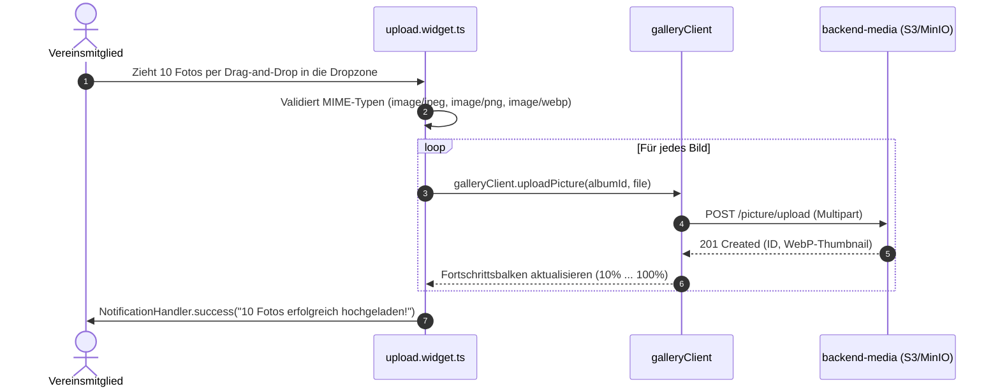

# Galerie Portal (`frontend-media` / `frontend-galerie`)

Das Submodul `frontend/frontend-media` stellt die Vereinsgalerie unter `https://galerie.kcfallum.de` (Port 8083) bereit. Es dient der Archivierung und Präsentation von Fotos vergangener Kegeltouren, Jubiläen und Vereinsabende.

---

## 1. Zweck & Funktionsumfang

* **Albenübersicht:** Kachelansicht aller Fotoalben mit Titelbild und Bildzähler.
* **Responsive Lightbox:** Vollbild-Ansicht von Fotos mit Zoomfunktion, Exif-Informationsanzeige und Tastaturnavigation (Pfeiltasten).
* **Drag-and-Drop Upload:** Komfortables Hochladen mehrerer Fotos gleichzeitig direkt im Browser.
* **Optimierte Auslieferung:** Verwendet moderne WebP-Thumbnails für schnelle Ladezeiten auf Mobilgeräten.
* **Privatsphäre & Download:** Generierung von zeitlich befristeten Presigned Download-URLs über den Media-Service.

---

## 2. Der Galerie-Upload-Flow

---

## 3. Berechtigungs-Matrix

* **Galerie einsehen (`galerie:view`):** Alle registrierten Mitglieder und freigeschaltete Gäste.
* **Fotos hochladen (`galerie:create`):** Alle aktiven Vereinsmitglieder.
* **Alben verwalten & löschen (`galerie:manage`):** Nur Administratoren und Event-Organisatoren.
