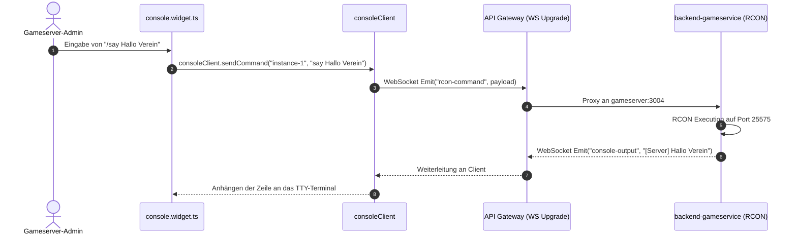

# Gameserver Web-Interface (`frontend-gameserver`)

Das Submodul `frontend/frontend-gameserver` ist das Steuerungs- und Überwachungsportal für Spieleserver unter `https://game.kcfallum.de` (Port 8082).

---

## 1. Zweck & Funktionsumfang

* **Live-Status:** Visualisierung von Online-Spielern, Ping, TPS (Ticks per Second) und Ressourcenverbrauch (RAM, CPU).
* **Interaktive RCON-Web-Konsole:** Echtzeit-Eingabe und Streaming der Minecraft-Server-Ausgaben via WebSockets.
* **Server-Lebenszyklus:** Starten, Herunterfahren, Neustarten und Klonen von Server-Instanzen.
* **Gamerules & Konfiguration:** Grafischer Editor für `server.properties` und Spielregeln (`keepInventory`, `pvp`, `difficulty`).
* **Backup-Snapshots:** Anzeige der mit Restic in MinIO gesicherten Welt-Snapshots und Auslösen von Wiederherstellungen.

---

## 2. Architektur: WebSocket-Streaming der Konsole

Die interaktive Konsole nutzt die Socket.io-Verbindung zum `backend-gameservice`:

---

## 3. Berechtigungs-Matrix

* **Ansicht (`gameserver:view`):** Alle authentifizierten Vereinsmitglieder dürfen den Serverstatus und die Spieleranzahl sehen.
* **Steuerung (`gameserver:manage`):** Nur Spieler mit Administrator- oder Gameserver-Rolle dürfen Server starten/stoppen und Backups erstellen.
* **Konsole (`gameserver:console`):** Streng geschützt; nur berechtigte Server-Operatoren haben Zugriff auf die interaktive RCON-Eingabe.
