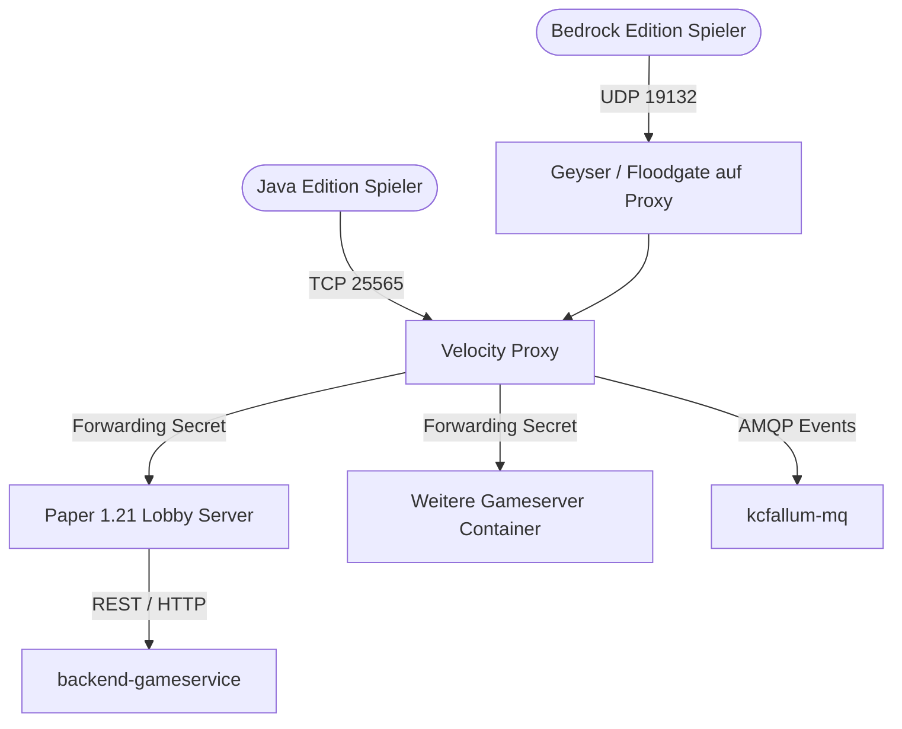

# Minecraft Plugins & Gaming-Infrastruktur

Das Verzeichnis `game/plugins` beinhaltet alle serverseitigen Erweiterungen für das Minecraft-Netzwerk des KC Fallum.

---

## 1. Komponenten & Submodule

* **`game/plugins/lib` (`minecraft-library`):**
  * Gemeinsame API- und Modelldefinitionen für Spigot/Paper und Velocity.
  * Veröffentlichung als Maven-Artefakt in GitHub Packages.
* **`game/plugins/lobby` (`minecraft-lobby`):**
  * Paper 1.21 Plugin für den Lobby-Server (`itzg/minecraft-server`).
  * Interaktion mit FancyNPCs, Audio-Chat (Simple Voice Chat) und Anbindung an `backend-gameservice`.
* **`game/plugins/proxy` (`minecraft-proxy`):**
  * Velocity-Proxy-Plugin (`itzg/bungeecord`).
  * Weiterleitung von Spielern zwischen Subservern, Synchronisation mit RabbitMQ und Floodgate-Authentifizierung für Bedrock-Spieler.

---

## 2. Cross-Play & Netzwerk-Topologie



---

## 3. Build-Workflow mit Gradle

Die Plugins werden mit Java 21 kompiliert. Der Root-Container stellt dafür ein PowerShell-Buildskript bereit:

```bash
# Kompiliert die Library lokal und baut die Shadow-JARs für Lobby und Proxy
npm run build:plugins
```

Das Skript platziert die fertigen JAR-Dateien automatisch in:
* `game/lobby/plugins/`
* `game/velocity/plugins/`
