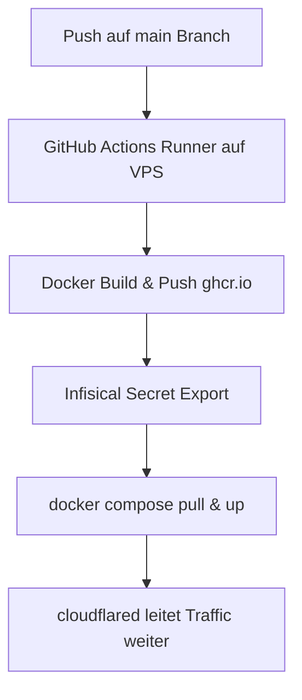

# Setup & Deployment Guide

Dieser Leitfaden beschreibt die lokale Installation aller Komponenten sowie das Deployment in der Produktionsumgebung.

---

## 1. Voraussetzungen

Folgende Softwarepakete müssen auf dem Entwicklungsrechner installiert sein:

* **Node.js:** Version 22 LTS oder Version 24
* **npm:** Version 10+
* **Docker & Docker Compose:** Docker Engine v26+
* **Git:** Version 2.40+ mit SSH-Schlüssel für GitHub
* **Infisical CLI:** Für die zentrale Secret-Verwaltung
* **Java 21 JDK:** (Optional, für Minecraft-Plugin-Builds)

---

## 2. Lokales Entwicklungs-Setup

### Schritt 1: Repository mit Submodulen klonen

```bash
git clone --recurse-submodules git@github.com:kc-fallum/root.git
cd root
```

### Schritt 2: GitHub Packages Authentifizierung (.npmrc)

Da die Pakete `@kc-fallum/*` in der GitHub Packages Registry liegen, muss ein GitHub Personal Access Token (PAT) mit dem Scope `read:packages` konfiguriert werden.

Erstelle oder bearbeite die globale Datei `~/.npmrc`:

```text
@kc-fallum:registry=https://npm.pkg.github.com
//npm.pkg.github.com/:_authToken=DEIN_GITHUB_PAT
```

### Schritt 3: Umgebungsvariablen (.env) laden

Die Umgebungsvariablen können direkt über Infisical synchronisiert oder aus der Vorlage kopiert werden:

```bash
# Über Infisical exportieren:
npm run env:dev

# Alternativ manuell aus der Vorlage:
cp .env.example .env
```

Passe in der `.env`-Datei lokale Werte wie `JWT_SECRET`, `DB_PASSWORD` und `MINIO_ROOT_PASSWORD` an.

### Schritt 4: Lokales Backend & Datenbanken starten

Die lokale Entwicklung nutzt `docker-compose.test.yml`. Dieser Stack startet PostgreSQL, RabbitMQ, Redis, MinIO, das Gateway sowie alle Microservices:

```bash
# Startet den gesamten Backend- und Datenbank-Stack
npm run start:backend
```

Die Dienste sind lokal unter folgenden Ports erreichbar:

| Dienst | Lokaler Port / URL |
|---|---|
| **API Gateway** | `http://localhost:3000` |
| **Swagger UI** | `http://localhost:3000/api-docs` |
| **PostgreSQL** | `127.0.0.1:5433` (User: `kegelclub_user`) |
| **RabbitMQ Management** | `http://localhost:15672` (User: `guest` / `guest`) |
| **MinIO Console** | `http://localhost:9001` |
| **Redis** | `127.0.0.1:6379` |

### Schritt 5: Frontends starten

Die Frontends können über Root-Skripte in parallelen Terminals gestartet werden:

```bash
# Startet alle Frontends gleichzeitig
npm run start

# Oder gezielt einzelne Frontends:
npm run start:client      # http://localhost:8080
npm run start:dashboard   # http://localhost:9090
npm run start:sso         # http://localhost:8000
npm run start:galerie     # http://localhost:7000
npm run start:gameserver  # http://localhost:6060
```

---

## 3. Produktions-Deployment (Oracle Cloud VPS)

Das Produktions-Deployment erfolgt automatisiert über GitHub Actions Workflows und den Cloudflare Tunnel.



### Schritt 1: Self-Hosted Runner auf dem VPS einrichten

Auf dem Oracle Cloud VPS laufen GitHub Actions Runner mit den Tags `[self-hosted, backend]` und `[self-hosted, frontend]`.

```bash
# Deployment-Verzeichnis auf dem Server vorbereiten
sudo mkdir -p /opt/deployment/kcfallum
sudo chown -R $USER:$USER /opt/deployment/kcfallum
cd /opt/deployment/kcfallum

# Root-Container klonen
git clone --recurse-submodules git@github.com:kc-fallum/root.git .
```

### Schritt 2: Produktions-Secrets synchronisieren

```bash
infisical export --env=prod --format=dotenv > .env
```

### Schritt 3: Cloudflare Zero Trust Tunnel konfigurieren

1. **Tunnel-Token in `.env` hinterlegen:**
   ```bash
   CLOUDFLARE_TUNNEL_TOKEN=eyJhIjoi...
   ```
2. **Tunnel als Service starten:**
   Im Stack `docker-compose.prod.yml` ist der Service `cloudflared` integriert:
   ```bash
   docker compose -f docker-compose.prod.yml up -d cloudflared
   ```
3. **Hostnames im Cloudflare Dashboard routen:**
   * `api.kcfallum.de` &rarr; `http://gateway:3000` (WebSockets aktiviert)
   * `kcfallum.de` &rarr; `http://client:80`
   * `auth.kcfallum.de` &rarr; `http://sso:80`
   * `dashboard.kcfallum.de` &rarr; `http://dashboard:80`
   * `galerie.kcfallum.de` &rarr; `http://gallery:80`
   * `game.kcfallum.de` &rarr; `http://gameserver:80`
   * `status.kcfallum.de` &rarr; `http://beszel:8090`

### Schritt 4: Gesamten Produktions-Stack booten

```bash
# 1. Infrastruktur & Datenbanken initialisieren
docker compose -f docker-compose.prod.yml up -d --no-build postgres-db db-boot message-broker redis minio minio-init cloudflared

# 2. Services pullen und starten
docker compose -f docker-compose.prod.yml pull
docker compose -f docker-compose.prod.yml up -d --remove-orphans
```

### Schritt 5: Automatische Updates über CI/CD

Sobald ein Commit in das `main`-Branch eines Submoduls gepusht wird, triggert der entsprechende Workflow (`backend-template.yml` oder `frontend-template.yml`):
1. Führt Linting, Tests und Quality-Gates (`fallow health`) aus.
2. Baut das Docker-Image und pusht es nach `ghcr.io`.
3. Zieht auf dem Server das neue Image und führt `docker compose up -d --no-deps --force-recreate <service>` aus.
